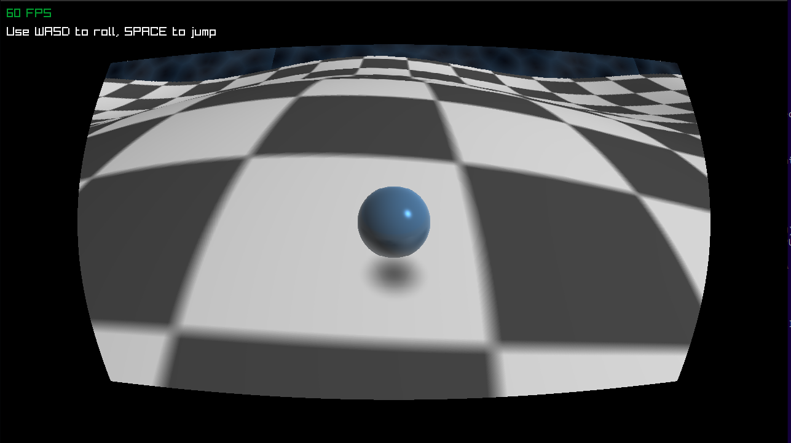

# Rolling Steel

A 3D tech-demo built with ` C` and `Raylib` where you control a highly reflective steel ball rolling across an infinitely scrolling, procedurally deforming checkered horizon.



## Features

- **Infinite Horizon**: A vertex shader deforms a static plane into rolling hills that loop infinitely as you move.
- **Custom GLSL Shaders**:
  - Fisheye (barrel distortion) post-processing effect.
  - Metallic environment-mapped shading for the steel ball.
  - Dynamic soft drop shadows that scale with height.
  - Procedural impact cracks rendered dynamically on the terrain.
  - Physics System: Real gravity, jumping, and momentum mechanics.
  - Procedural Audio: Jump and landing sound effects are mathematically generated in-memory on startup—no external .wav files required! (Background music utilizes streaming).
  - Parallax Background: Layered, moving sky textures.

### Requirements

To compile and run this project, you need:
- A C compiler (GCC, Clang, etc.)
- Raylib installed on your system.

### How to Compile (Linux)

Run the following command in your terminal (make sure drone.mp3 is in the same directory if you are using the background music, and that you have the Raylib static library located at `/usr/local/lib/libraylib.a`):
```bash
make
./RollingSteel
```

(Note: If you are on Windows or macOS, your compile command will vary slightly according to your Raylib installation).

### Controls

- W, A, S, D or Arrow Keys: Roll the terrain.

- Spacebar: Jump.

- ESC: Quit the game.
